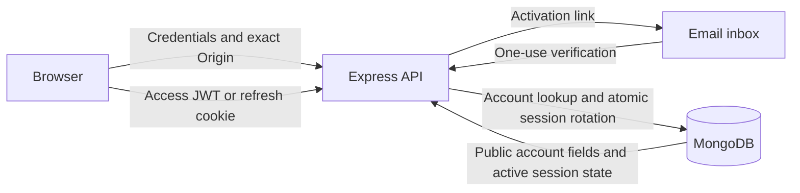

# From a JWT demo to a reviewed authentication service

**Author:** Timofei Chizhov · **Area:** Application / Product Security

**Verification snapshot:** 20 October 2026

**Baseline:** [`aaa13945d4c7dfd03e4510fdc109b92720fc52ec`](https://github.com/kwtpub/JWT-authentication/tree/aaa13945d4c7dfd03e4510fdc109b92720fc52ec)

## Context and scope

I revisited my earlier full-stack authentication project as an AppSec exercise. The goal was to connect security findings to application behavior and verifiable fixes, while keeping the project small enough to inspect.

The scope covers Express routes, authentication and activation services, JWT validation, MongoDB session state, cookies, request validation, dependencies, and repository hygiene. Verification used a local HTTP harness, temporary MongoDB, synthetic accounts, and a captured mail transport. No production service was probed and no real user's data was used.

Severity below is a qualitative assessment for this application, not a calculated CVSS score. Dependency advisory severity is reported separately and does not demonstrate that every advisory is reachable through these routes.

## Threat model

Protected assets are password hashes, activation capabilities, refresh credentials, access credentials, and account identity. Relevant actors include an unauthenticated client, a malicious registered user, a browser on an untrusted origin, a holder of a previously consumed refresh token, and someone reading database records or repository history.

The main trust boundaries are the browser/API boundary, the API/database boundary, and the email verification boundary. An authenticated user must not gain access to another user's credentials. A refresh token must not cross into JavaScript-readable JSON, and using a consumed token must not silently produce another valid session.



## Findings and remediation

### F01 — Credential disclosure through the users endpoint · High

**Evidence:** the original [`getAllUsers`](https://github.com/kwtpub/JWT-authentication/blob/aaa13945d4c7dfd03e4510fdc109b92720fc52ec/service/user-service.js) returned `UserModel.find()` and the controller serialized the documents directly. An account created with an unverified email could call `/api/users` and receive password hashes and activation links. This crossed the account authorization boundary and provided material for offline guessing and activation misuse.

**Fix:** removed the directory endpoint. `/api/me` derives identity from a verified access JWT and an active server-side session, then returns an explicit `{id, email, isActivated}` DTO. Password and activation fields are excluded from normal model selections.

**Regression:** `/users` returns `404`; `/me` returns only the caller's allowlisted fields even when another account exists.

### F02 — Weak password policy and inexpensive password hashes · High

**Evidence:** the registration validator accepted three characters. The source passed a cost of `3` to bcrypt; the library clamped this to an effective cost of **4**, confirmed by `bcrypt.getRounds()`. This made the leaked hashes substantially cheaper to guess than the updated configuration.

**Fix:** registration requires at least 15 characters and at most 72 UTF-8 bytes. Existing bcrypt storage is retained with cost **12**, and lower-cost hashes are upgraded after a successful login. The byte limit prevents silent bcrypt truncation for multibyte passwords. This is a compatibility choice for a legacy bcrypt project; a new design should consider memory-hard password hashing.

**Regression:** short and oversized Unicode passwords are rejected without echoing them; login upgrades a synthetic cost-4 hash to cost 12.

### F03 — Email activation did not gate account access · High

**Evidence:** registration and login issued tokens regardless of `isActivated`. Activation links had no expiry or one-use consumption, and the mail service printed the recipient and link instead of sending email. The application therefore had an activation concept without a working verification boundary.

**Fix:** registration creates a pending account and returns no tokens. Activation uses a random 256-bit capability, stores only its SHA-256 digest, expires it after 24 hours, and consumes it atomically. Login requires an activated account. The mail transport sends the link without logging it. Resend supports migrated/expired accounts, with IP throttling and a one-minute account cooldown.

**Regression:** pending users cannot log in; expired, reused, and malformed links fail; two concurrent activations have exactly one winner. Resend and delivery-failure behavior are also tested.

### F04 — Refresh replay, non-atomic rotation, and plaintext session credentials · High

**Evidence:** signing the same payload in the same second produced identical refresh JWTs. The original refresh path separately read a token record and saved its replacement. The local reproduction sent two simultaneous requests with one cookie and received **`200, 200`**. Refresh tokens were stored verbatim in MongoDB.

**Fix:** new JWTs have random IDs, explicit access/refresh purposes, separate keys and audiences, and a fixed issuer and algorithm. MongoDB stores only a SHA-256 refresh digest, session-family ID, user ID, and absolute expiry. Rotation performs a compare-and-swap against the current digest. A valid consumed token revokes its own family, including any newly rotated token. Tokens from an older login family cannot revoke a newer login.

The application checks active session state on access requests, so family revocation and logout take effect immediately. A unique user index enforces the deliberate single-session policy; a TTL index provides cleanup while expiry is also checked directly in queries.

**Regression:** same-second issuance produces distinct JWTs; parallel refresh returns **`200, 401`**, then the family is unusable. Sequential replay, absolute expiry, logout, old-family isolation, and database indexes are tested against MongoDB.

### F05 — Refresh credentials crossed the response boundary · Medium

**Evidence:** responses included `refreshToken` in JSON while also setting an HttpOnly cookie. The JSON copy was readable by frontend JavaScript, so HttpOnly did not protect that copy. Cookies did not explicitly set `Secure` or `SameSite`, and refresh used GET to mutate session state.

**Fix:** session responses contain only `{accessToken, user}`. Refresh credentials are sent through a host-only, HttpOnly cookie scoped to `/api`, with `SameSite=Strict` and `Secure` in production. Authentication responses are not cacheable. Refresh requires POST; every POST checks the exact configured Origin and rejects absent/null values.

**Verification boundary:** HTTP tests verify server behavior and cookie attributes. They do not claim to reproduce an XSS exploit or a browser-level CSRF exploit. Browser defaults and deployment topology affect exploitability of the original cookie configuration.

### F06 — Credential abuse and weak input/error boundaries · Medium

**Evidence:** missing-user and wrong-password responses had different messages. Login had no schema validation or throttling. An operator object in the email field could reach query construction; no password-check bypass was demonstrated. Validation error objects could also include submitted credential values.

**Fix:** email/password inputs must be bounded strings; errors never serialize submitted values. Unknown, wrong-password, and pending accounts share one credential error, with dummy bcrypt work for unknown users. Login is limited to 10 requests per 15 minutes per socket IP; registration and resend to 5; all API routes also have a shared per-IP budget of 300. A 10 KiB JSON limit and generic parse/internal errors constrain the request/response boundary.

**Regression:** operator objects, arrays, malformed JSON, oversized bodies, distinct failure cases, and throttling are tested. JWT parsing also rejects missing/incorrect claims and unsupported algorithms. The algorithm allowlist is defense in depth; this review does not claim that the original jsonwebtoken version accepted unsigned JWTs.

### F07 — Outdated dependency graph · Advisory-dependent

**Evidence:** the initial lockfile audit reported **17 vulnerable-package entries: 1 critical, 12 high, 4 moderate**, including transitive packages and development tooling. The [unmodified audit JSON](evidence/dependency-audit-before.json) preserves advisory URLs and affected ranges. For example, the critical proxy-addr advisory depends on proxy trust configuration; its presence alone was not proof of a remote exploit in this application.

**Fix:** updated supported dependency lines, upgraded Nodemailer, removed unused direct MongoDB/uuid dependencies, and replaced nodemon with Node's built-in watch mode. CI installs the lockfile, runs security regression tests, and audits all dependencies. Third-party CI actions are pinned to full commit SHAs with read-only repository permissions.

**Result at verification:** `npm audit` reported **0 known vulnerable-package entries** for the updated dependency graph. This is a point-in-time scanner result, not a guarantee of vulnerability absence.

### F08 — Runtime credentials and vendored modules in Git · Low / contextual

**Evidence:** the baseline tracked a cookie jar containing JWT-shaped data and a partial `node_modules` tree. Historical credentials can remain accessible even after removal from the current tree.

**Fix:** removed these artifacts and OS metadata from version control, retained the lockfile, and added ignore rules plus a secret-free `.env.example`. A separately invoked maintenance migration revokes database sessions and clears activation capabilities before the new schema is used.

**Boundary:** no history rewrite or deployed key rotation was performed. No historical token was tried against a live service. Operators of an existing deployment must perform session migration and review any previously exposed credentials.

## Reproduce and verify

```sh
npm ci --ignore-scripts
npm run reproduce:baseline
npm test
npm audit --audit-level=moderate
```

The baseline runner reads source from commit `aaa1394`, copies only application modules into a temporary directory, and exercises them using synthetic accounts. It uses the current patched dependency graph and an equivalent `crypto.randomUUID()` replacement for legacy `uuid.v4()`. The archived [baseline results](evidence/baseline-results.json) record the original local observations; the dependency audit was captured separately from the original lockfile. The runner deliberately avoids printing bearer tokens or password hashes.

All **36 regression tests passed** in the [recorded local verification](evidence/verification.json). The suite uses real HTTP requests, cryptographic verification, bcrypt, and a disposable MongoDB 8.2.6. SMTP delivery is captured in tests. The database migration is also executed against a disposable fixture, verifying that accounts survive and legacy session material is removed; normalization collisions abort before data is changed.

## Limitations and tradeoffs

- This is a source review and local regression exercise. There was no deployed penetration test, browser end-to-end test, real SMTP deliverability test, or production-load benchmark.
- Single-session semantics keep revocation understandable. A client must serialize refreshes; legitimate parallel refreshes trigger the same fail-closed behavior as replay.
- Immediate access-token revocation requires a MongoDB session lookup on each protected request. Database availability is part of authentication availability.
- Rate limits are per IP and process-local. Distributed attacks, multiple replicas, restarts, and shared proxy addresses need a shared store and an account-aware strategy. Generic responses and dummy work reduce obvious enumeration but do not prove timing indistinguishability, particularly for legacy hashes and email transport failures.
- Bcrypt remains for compatibility. Existing short passwords are not forcibly changed by this patch; a deployed system should add password reset, breached-password screening, and migration to a modern memory-hard hash. MFA, recovery, and account lifecycle management are outside this case.
- `SameSite=Strict` assumes a same-site frontend/API deployment. HTTPS termination, trusted proxies, request logging, and secret storage must be reviewed in the deployment environment.
- A database write and external email delivery are not a transaction. An outbox and durable mail retries would improve reliability beyond this demonstration.
- Scanner results and tests establish specific properties, not a universal claim that the application is secure.

## References

- [OWASP Authentication Cheat Sheet](https://cheatsheetseries.owasp.org/cheatsheets/Authentication_Cheat_Sheet.html): credential responses, password policy, throttling.
- [OWASP Password Storage Cheat Sheet](https://cheatsheetseries.owasp.org/cheatsheets/Password_Storage_Cheat_Sheet.html): bcrypt work factors, byte limits, legacy upgrades.
- [OWASP CSRF Prevention Cheat Sheet](https://cheatsheetseries.owasp.org/cheatsheets/Cross-Site_Request_Forgery_Prevention_Cheat_Sheet.html): Origin checks and SameSite boundaries.
- [RFC 9700, section 4.14](https://www.rfc-editor.org/rfc/rfc9700.html#section-4.14): refresh replay detection as a design reference. This demo is not an OAuth authorization server.
- [jsonwebtoken documentation](https://github.com/auth0/node-jsonwebtoken): signing and verification options.
- [express-rate-limit documentation](https://express-rate-limit.mintlify.app/overview): process-local versus shared stores.
